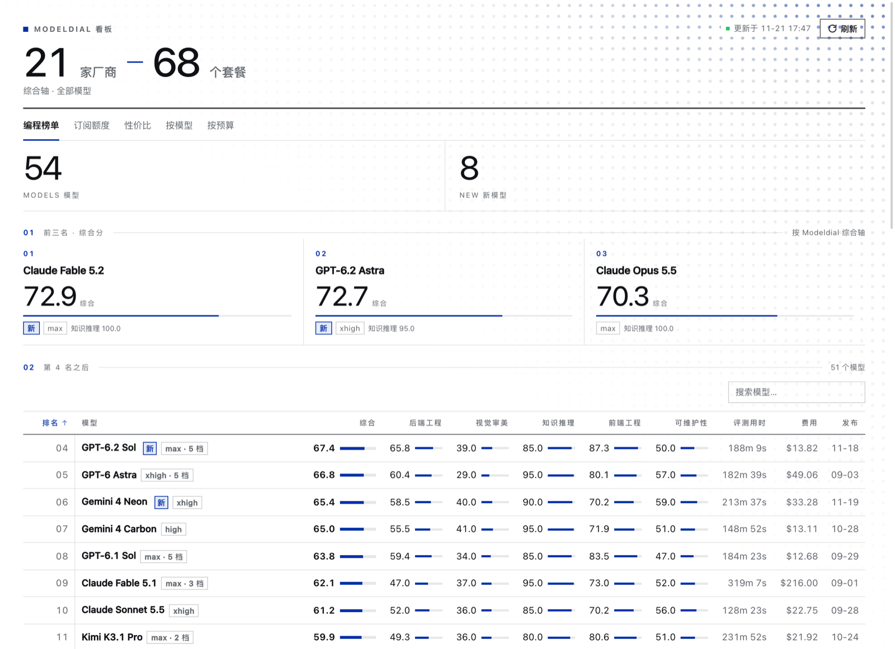
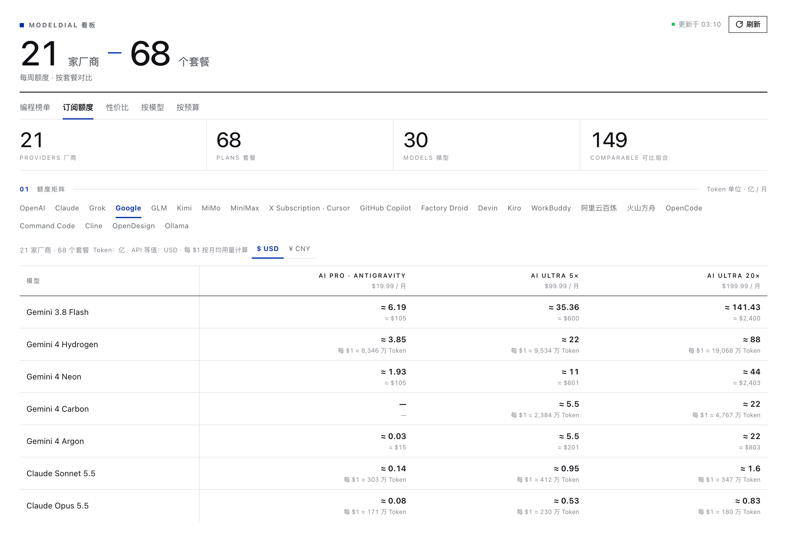

# Modeldial 看板

DeepSeek Harness 的侧栏面板插件：把 [modeldial.com](https://modeldial.com) 的三张榜（编程、文本能力、Harness）和订阅额度实测搬进 app 里，抓一次数据，七个页签横着看。




## 七个页签

- **编程榜单** — 55 个模型的综合分、后端工程、视觉审美、知识推理、前端工程、可维护性、评测用时、费用、发布日期。前三名大号字报，第 4 名往后是紧凑表格；11 列全部可排序，支持搜索。
- **文本能力榜** — 38 个模型的文本总分、理解、输出，行可展开看 8 个评分维度（语义辨析、证据整合、意图推断、规则应用、文本表达、文体适配、叙事推进、成稿完整度）。写作/翻译选型看这张，不要拿编程榜代替。
- **Harness 榜** — 23 个 harness 本体的综合分、稳定完成率、时间效率、成本效率，行可展开看软件工程、系统运维、数据分析、科研与仿真、安全攻防、推理规划、办公交付、多媒体处理 8 个能力域。选 agent 工具看这张。
- **订阅额度** — 21 家厂商、68 个套餐的额度矩阵，默认「全部」按厂商分段，也可只看一家。上游把额度混着按周和按月给，面板统一折成月显示，原值留在 tooltip 里。USD / CNY 双向换算。
- **性价比** — 149 个「套餐 × 模型」组合按每 $1（或每 ¥1）换到的 Token 排序，可按厂商过滤。
- **按模型** — 选一个模型，看哪些厂商的哪些套餐收录它、各自给多少额度。28 个模型按厂商分组（额度侧和榜单侧的模型名有别名，已合并），默认按性价比排。
- **按预算** — 输入月预算和月用量，看哪些套餐买得起、够不够用。逐个套餐汇总「N 个模型能撑满整月」，可展开看明细。

三张榜的量纲不同（编程综合轴、文本总分、Harness 综合分），不要跨榜比分数。上面这些数字都随上游变动，面板按实际抓到的数据算，不写死。

## 设计

瑞士编辑排版：刊头双段大字 + KPI 数字格、章节编号配发丝线、零圆角零阴影。颜色一律走宿主主题 token（`--dsw-alias-*`），暗色自动跟随；强调色 IKB 蓝 `#002FA7`，暗色下提亮为 `#96B0FF`。

## 数据来源

| 来源 | 地址 | 解析 | 缓存 |
|---|---|---|---|
| 编程榜单 | <https://modeldial.com/leaderboard/coding?axis=overall> | SSR HTML | 4 分钟 |
| 文本能力榜 | <https://reference.modeldial.com/writing-snapshots/current.json> | 官方 JSON 快照 | 15 分钟 |
| Harness 榜 | <https://modeldial.com/leaderboard/harness> | SSR HTML | 10 分钟 |
| 订阅额度 | <https://modeldial.com/subscriptions?period=week&view=catalog&currency=CNY> | SSR HTML | 10 分钟 |

文本能力榜的页面是客户端渲染，直接抓 HTML 只有空壳；它自己读的就是上面那份官方快照 feed，所以面板抓同一份 JSON，不跑浏览器、不调第三方 API。额度页有两种结构：8 家用 `<table>` 矩阵，另外 13 家用「一行一档位、档位里嵌模型」的卡片，Host 端把后者还原成同样的矩阵。

点「刷新」可强制抓新数据（`?force=1` 跳过缓存），只刷当前页签对应的那一个源。

## 缓存与落盘

- 进程内缓存按上表的 TTL 走，并做单飞（并发请求只抓一次）。
- 每个源最后一次成功的数据会原子写到 `${DSH_HOME:-~/.dsh}/cache/modeldial-leaderboard/<key>.json`。DSH 重启后先读盘，面板立刻有内容并标出上次抓取时间，不用等上游。
- 上游支持 ETag 的源（文本榜）会带 `if-none-match` 重新验证，304 只刷新时间戳。
- 网络错误 / 5xx 会重试一次（退避 800ms）；解析失败不重试，直接报「结构可能变了」。

## 人民币折算

额度页原站只渲染美元。切到 CNY 时按 `open.er-api.com` 的美元汇率折算月费、API 等值和「每 ¥1 Token」，并在开关旁标出所用汇率；汇率接口取不到时退回固定值 6.69 并标注「估算」。

所有金额输入框（按预算页）在币种切换时按汇率同步换算，不会把 ¥134 当成 $134 再算一遍。

## 容错

- 抓取失败：顶部显示红色提示和「重试」，继续显示上一次成功的数据并标注时间，不会变成空榜。
- 上游结构变了、解析不到行：按失败处理，提示「页面里没有解析到模型行」。
- 上游整格留空（如 Claude Pro 档的 Fable 5.2）：显示 `—` 或「额度未知」灰胶囊，不计入「不够」，也不会让覆盖模型数少算。
- 整列都没有数据的列（如按模型页的 API 等值）自动隐藏，不留一片空白。

## 接口

```
GET /__modeldial/leaderboard   # 编程榜单，?force=1 跳过缓存
GET /__modeldial/quota         # 额度矩阵，?force=1 跳过缓存
GET /__modeldial/writing       # 文本能力榜，?force=1 跳过缓存
GET /__modeldial/harness       # Harness 榜，?force=1 跳过缓存
```

返回 `{ ok, cached, from, fetchedAt, error, data }`；失败时 `ok: false` 且仍带上次的 `data`。`from` 标明这份数据来自 `network` / `memory` / `disk`，只用于排查。

## 测试

零依赖，用 Node 自带的 test runner：

```bash
npm run check   # node --check index.js client.js
npm test        # 解析器 + 四个路由 + 落盘/重启 + 客户端渲染冒烟
```

`test/fixtures/` 是从上游裁剪下来的样本（CI 不联网）。上游改版导致解析失败时，跑 `node scripts/refresh-fixtures.mjs` 重新生成再对照 diff。

## 安装

先把仓库克隆或解压到任意目录（下称 `<插件目录>`，用绝对路径），再把它链进你正在使用的 profile：

```bash
# <profile> 换成你实际的 profile 名，默认是 desktop
mkdir -p ~/.dsh/profiles/<profile>/node_modules/@local
ln -s "<插件目录>" ~/.dsh/profiles/<profile>/node_modules/@local/modeldial-leaderboard
```

然后编辑 `~/.dsh/profiles/<profile>/package.json`，在 `dependencies` 里加一行：

```json
"@local/modeldial-leaderboard": "link:<插件目录>"
```

并在同文件的 `dsh.profile.bundles` 数组里加上 `@local/modeldial-leaderboard`。

重启 DSH 生效（Host 端只在启动时载入一次；之后只改 `client.js` 刷新页面即可）。

## 许可

MIT，见 [LICENSE](LICENSE)。可以自由使用、修改、分发，保留版权声明即可。

## 卸载

从 `package.json` 的依赖和 `dsh.profile.bundles` 里移除，删掉软链，重启 DSH。
